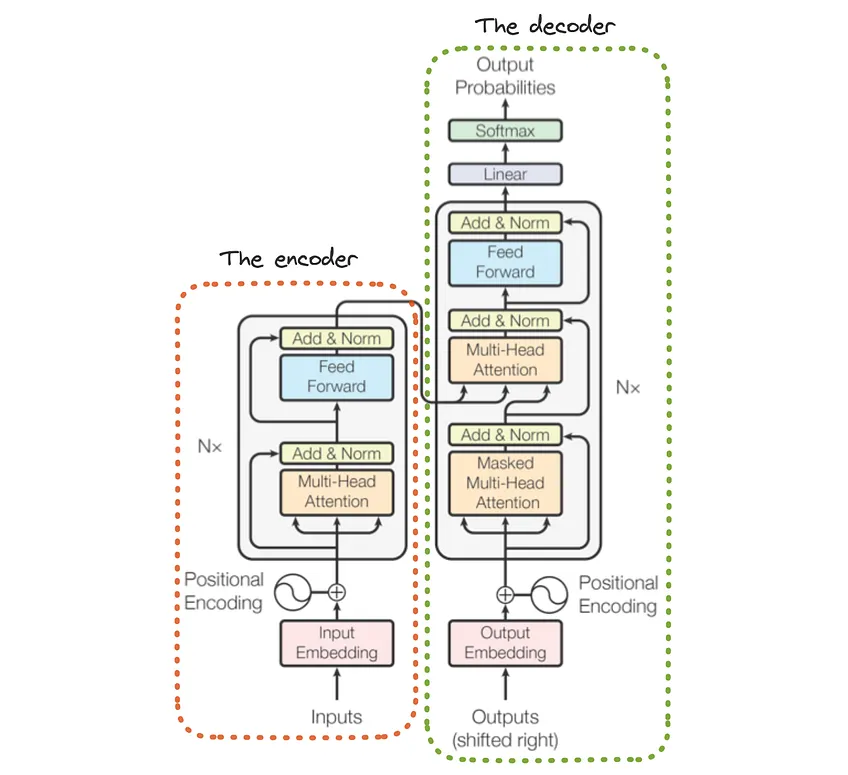
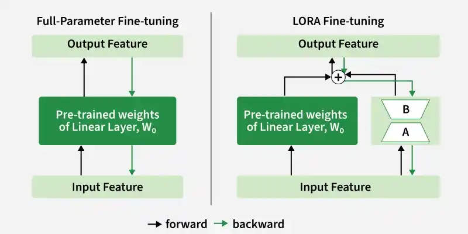
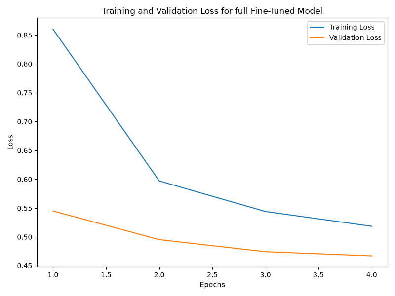
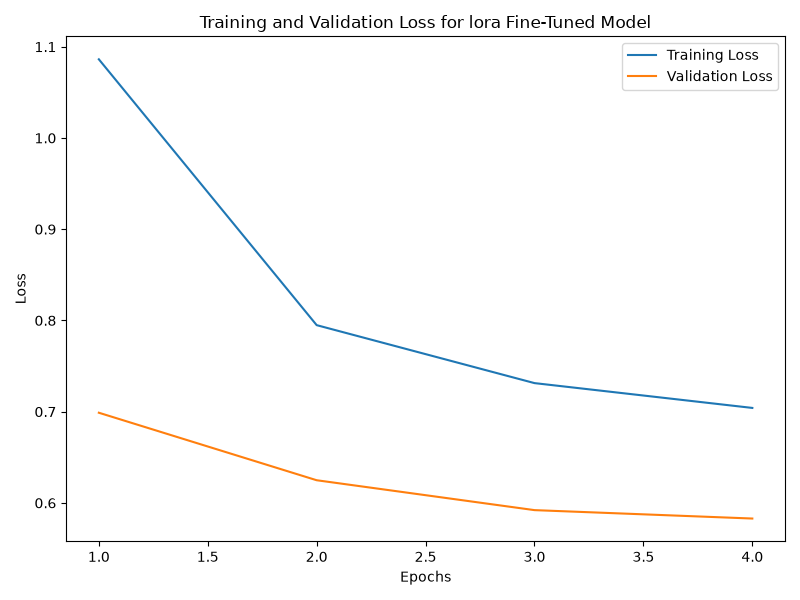
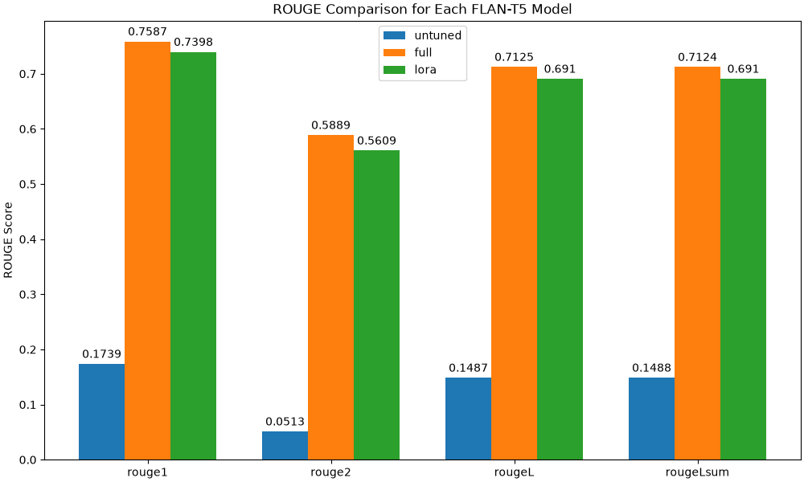

# Radiology Report Summarisation using FLAN-T5: Investigating the Effects of Full Fine-Tuning and LoRA 

## 1. Overview
### 1.1 Problem Description
Radiology reports quite often contain complex wording and specialised medical terms. This can cause patients to not fully understand their results, potentially leading to confusion and higher anxiety. Using simple translation methods to summaries the reports can reduce this issue. However there is a high risk of translation/generation errors such as stating incorrect information, missing key details and distorting clinical certainty.

### 1.2 Project Objective
This project aims to investigate how Google's FLAN-T5 model, through fine-tuning, can increase both the layman readability of reports whilst still maintaining clinical accuracy on the BioLaySumm 2025 dataset. Three model configurations were compared within the project including an untuned baseline, full fine-tuning and Low-Rank Adaptation (LoRA) fine-tuning. The models were evaluated lexicographically using ROUGE scores, computationally using metrics such as peak VRAM and training time, and clinically through a manually safety audit. The main objective of the project was to explore whether improvements in lexical similarity (through ROUGE) correlates to better clinical factual accuracy, or whether fine-tuned models still contain potential harmful errors. 

## 2. Algorithm and Architecture 
### 2.1 FLAN-T5 Architecture
Google's FLAN-T5-base model is used as the foundational model of the project. It is an instruction tuned Large Language model which is suited for multiple natural language problems such as translation, summarisation and question answering. It uses an encoder-decoder transformer architecture where the encoder processes the input text sequence and the decoder generates the corresponding output sequence. 

Although FLAN-T5 is well suited for general summarisation, it is not optimised specifically for clinical radiology reports, which is where fine-tuning comes in. Fine-tuning the model using the BioLaySumm dataset allows the model to better learn medical terminology in order to produce summaries that can be better understood by patients, whilst still preserving key clinical information.  



*Figure 1: FLAN-T5 model architecture*

### 2.2 Full Fine-Tuning
Full fine-tuning involves updating all of the models parameters during training in order to get better performance specifically using the BioLaySumm training dataset. During the forward pass, the inputs are processed through the model, while backpropagation calculates the gradients in order to update entire model's weight matrix. However this approach can be more computationally expensive, requiring higher GPU memory usage in order to calculate/store gradients and update parameters.

### 2.3 Low-Rank Adaptation (LoRA)
Low-Rank Adaptation aims to make fine-tuning more efficient by reducing the number of parameters that are updated during training. This is done by freezing the original model's weight matrix and introduces two smaller matrices within selected layers. These matrices are updated during training and then are merged with the original weight matrix after training to produce the final model. Similarly to full fine-tuning, a forward pass is performed on the original weight matrix (plus the smaller matrices for LoRA), however backpropagration is only performed on the smaller matrices. 

By training on just the smaller two matrices, LoRA significantly reduces the amount of trainable parameters, therefore reducing the computational requirements. However by limiting the parameter updated to a smaller subset, the model's ability to learn clinical summarisation may be limited compared to full fine-tuning.



*Figure 2: Comparison of full fine-tuning and LoRA*

## 3. Dataset and Preprocessing
### 3.1 BioLaySumm Dataset
The main dataset used within the project is the BioLaySumm 2025 Layman RRG dataset, which contains radiology reports along with corresponding summaries suited for a general audience. The reports are used as the model's inputs, and the summaries are used as the target outputs during the training process. An example report and summary can be seen below.

**Report**: Cardiomegaly. Hiatal hernia. No areas of consolidation are observed. 

**Summary**: The heart is enlarged, and there is a hernia at the diaphragm opening. No areas of lung consolidation are seen.

### 3.2 Data Preprocessing
Before the data inputs are passed to the models, an instruction prompt is added to the beginning of each report. This provides the FLAN-T5 model with guidance to generate layman summaries whilst preserving key clinical details. The exact prompt used can be seen below.

**Prompt**: Summarise the medical report into lay language for a general audience, the summary should be simpler and easier to understand whilst still preserving all important clinical findings: 

After this, both the reports and the summaries are tokenised using the pretrained FLAN-T5-Base tokeniser. The input reports are truncated to a max token length of 512, while the summaries are truncated to 256 tokens. These lengths were chosen in order to limit the computational requirements and GPU memory usage. Through an analysis it was observed that these limits ensure that atleast 98% of the data is never truncated. However, truncation on the remaining longer data sequences introduces the risk of removing important clinical information before it is even passed to the models.

It was observed that the median token length was roughly 41 tokens. Due to this dynamic padding was used in order to pad sequences to the max length within each batch rather than padding everything to the predefined max token length. This reduces excessive padding and therefore reduces the computational requirements. Additionally, the padding tokens for the summary sequences were masked to a value of -100, this ensured that they were ignored when calculating losses.

### 3.3 Data Splits
The dataset contained predefined training, validation and testing sets. An initial check was conducted on a subset of the data in order to determine if any reports were duplicated across the splits. No duplicates were seen within this subset, although the entire dataset was not completely checked. Therefore, within the project the predefined splits were maintained in order to reduce the risk of data leakage. 

| Dataset Split | Number of Samples | Purpose |
| --- | --- | --- |
| Training | 150,454 | Fine-tuning the models |
| Validation | 10,000 | Observing validation losses, selecting checkpoints, and calculating overall ROUGE scores |
| Test | 10,537 | Generating unseen examples for the clinical safety audit | 

Note that both training and validation sets contained the radiology reports as well as the layman summaries. Whereas the test set did not contain the layman summaries for the corresponding reports. Because of this the models performance (using ROUGE) was evaluated on the validation set, while the test set was saved for the manual clinical safety audit.

## 4. Implementation and Training
### 4.1 File Structure
```
Flan_T5_s4803010/
├── reference_images/    # Contains images used within the report
├── README.md            # The project's report
├── dataset.py           # Loads, tokenises and prepares the data into DataLoaders
├── modules.py           # Defines the FLAN-T5 and configures LoRA adaption
├── predict.py           # Loads the trained models to generate summaries
├── train.py             # Handles training, validation and evaluation
└── requirements.txt     # Dependencies
```

### 4.2 Training Configurations
Both fine-tuned models use similar training setups/procedures in order to compare fairly between the two methods. BF16 mixed precision was used for both models to reduce the memory requirements, and gradient clipping (with a max norm of 1.0) was used limit the risk of exploding gradients. After each training epoch, the models are evaluated on the validation set, where the checkpoint is saved every time validation loss decreases over epochs. Early stopping, with a patience of two epoch was implemented to reduce the chance of overfitting, however it was never triggered as all models trained for the full four epochs. Below is the hyperparameters used for training each model.

| Hyperparameter | Full Fine-Tuning | LoRA |
| --- | --- | --- |
| Epochs | 4 | 4 |
| Batch size | 8 | 8 |
| Learning Rate | 5e-5 | 1e-4 |
| Optimiser | AdamW | AdamW |
| Weight Decay | Linear decay | Linear decay |
| Warmup Steps | 5% of total steps | 5% of total steps | 
| Mixed Precision | BF16 | BF16 |
| LoRA rank | N/A | 16 |
| LoRA alpha | N/A | 32 |
| LoRA dropout | N/A | 0.05 |
| LoRA target modules | N/A | all-linear |

### 4.3 Evaluation Process
The three models were evaluated numerically on the entire validation set using ROUGE-1, ROUGE-2, ROUGE-L and ROUGE-Lsum. The ROUGE metrics measure lexical similarities between the n-grams of the generated and reference summaries. Although ROUGE is able to be used as a numerical measure of summarisation performance, it cannot directly evaluate clinical accuracy, which is why an additional manual safety audit is conducted as described below.

The clinical safety audit was conducted on five randomly selected reports from the test dataset. The generated summaries for all three models are compared manually using human judgement in order to identify hallucinations, missing medical details and general readability. 

Additionally to these two evaluation processes, the computational performance of each model is compared. This included model total and trainable parameter counts, Peak VRAM and inference throughput (the number of tokens generated per second). These metrics allowed for the analysis of specific trade-off between generation performance and computational requirements across the three models. 

### 4.4 Hardware Configurations
| Component | Configuration |
| --- | --- |
| Platform | UQ Rangpur HPC Cluster |
| GPU | NVIDIA A100 |
| GPU VRAM | 40GB |

### 4.5 Installation and Usage
The project was implemented using Python 3.12.13. The exact libraries and dependencies used within the project are recorded within `requirements.txt`, while a summarisation of the main dependencies can be seen below.

| Dependency | Version |
| --- | --- |
| Python | 3.12.13|
| PyTorch | 2.14.0 |
| Transformers | 4.57.6 |
| PEFT | 0.21.2 |
| Datasets | 5.0.1 |
| Evaluate | 0.4.6 |
| rouge-score | 0.1.2 |
| Matplotlib | 3.11.2 |
| Pandas | 3.0.6 |

To install the required dependencies, make a Python 3.12 environment and run the following command from the project's directory:

```pip install -r requirements.txt```

The training and evaluation experimentation loop can be run from the root using"

```python recognition/Flan_T5_s4803010/train.py```

This trains both the full fine-tuning and LoRA models before evaluating all three models. The best performing checkpoints are then stored within the directory `models/`, while the results are stored within `results/`.

## 5. Experimental Results
### 5.1 Training and Validation Comparison
Both of the full fine-tuned and LoRA fine-tuned models were trained over 4 epochs on the training dataset. The training and validation losses were measure at each epoch to ensure the models were training correctly. The epoch with the best validation loss was saved as the best performing checkpoint.

| Metric | Full Fine-Tuning | LoRA Fine-Tuning |
| --- | --- | --- |
| Best Epoch | 4 | 4 |
| Best Training Loss | 0.5185 | 0.7041 |
| Best Validation Loss | 0.4673 | 0.5829 |

From the results above it can be seen that the Full Fine-Tuning model outperformed the LoRA model on both training and validation loss. This suggests that updating all of the model's parameters allows it to learn more effectively in order to better specialise on the radiology summarisation problem. 

As seen below in figures 3 and 4, the training and validation losses for both model decreased steadily across all four epochs. This demonstrates that were both successfully learning in order to perform better on the two sets. Additionally, there is no noticeable sign that either model is overfitting to the training data as it can be seen that the validation loss is decreasing along with the training loss. However, since both models had the final epoch (epoch 4) as their best performing epoch, this suggests that they were both still learning. Therefore the models may benefit from more training, but it will require additional computational resources.



*Figure 3: Training and Validation Losses for Full Fine-Tuning*



*Figure 4: Training and Validation Losses for LoRA Fine-Tuning*

### 5.2 Summarisation Comparison
The summaries generated by the three models were evaluated on the validation set using the ROUGE metrics which measure lexical similarities.  
ROUGE1: Unigram overlap  
ROUGE2: Bigram overlap  
ROUGEL: Longest common subsequence (LCS)  
ROUGELsum: Summary level LCS  



*Figure 5: ROUGE score comparison across the three FLAN-T5 models*

From figure 5 above it can be seen that fine tuning the model leads to a significant improvement across all metrics compared to the untuned baseline. Full fine-tuning increased the average ROUGE score, compared to the baseline, by roughly 430%. Similarly, applying LoRA fine-tuning increased the average ROUGE score by 413%. This suggests that both fine tuning models successfully allow the model to perform better on the specific radiology summarisation problem. 

Although the full fine-tuned model outscores the LoRA model across all four ROUGE metrics, the differences in scores are minimal compared to not fine tuning at all. This also shows that even though the LoRA model trained on significantly less parameters than the full fine-tuned model, it still achieved similar performance. 

This comparison demonstrates that fine tuning the model will significantly improve performance on a lexical level. However, no conclusions can be made yet, as to whether the clinical accuracies also improve after fine tuning. This is later explored in the manual clinical safety audit in section 6.1.

### 5.3 Computational Comparison

| Metric | Untuned Baseline | Full Fine-Tuning | LoRA Fine-Tuning |
| --- | --- | --- | --- |
| Total Parameters | 247.58M | 247.58M | 247.58M | 
| Trainable Parameters| N/A | 247.58M | 6.78M |
| Training Time | N/A | 3h 28m | 5h 47m |
| Peak Training VRAM | N/A | 13.49GB | 11.74GB |
| Inference Throughput | 193.26 tokens/s | 160.12 tokens/s | 96.89 tokens/sec |

The result table above demonstrates that LoRA fine-tuning, which had considerably less trainable parameters than the full fine-tuned model, ended up having a lower peak VRAM usage during training. However this reduction in VRAM usage is not directly proportional to the reduction in trainable parameter, since LoRA used 2.7% of the parameter but only managaed to reduce the peak VRAM to 87.32% of the peak VRAM of full fine-tuning. 

Interestingly, even though the LoRA model updated far less parameters, it took 2 hours and 19 minutes longer to train compared to the full fine-tuned model. Additionally the LoRA model was noticeably slower at generating output tokens compared to the other two models, with it's inference throughput being only 50.13% of the untuned model and 60.48% of the full fine-tuned model. This may be due to the LoRA models target modules being set to 'all-linear', which applies the LoRA adapters to all linear layers of the model. Due to this the additional overhead of dealing with the matrix operations of the smaller matrices may outweigh the computation benefits of updating less parameters. The target module was chosen to be 'all-linear' as it allows for a closer performance comparison to the full fine-tuned model. Future experiments could be conducted using the target module as ['q', 'k'], (just the query a key layers), which may reduce computational requirements but at the same time may reduce generation performance. 

Overall the comparisons conducted on the experiments results suggest that the full fine-tuned model is quantitatively the 'best' choice in model. This is because it had far better performance on the ROUGE metrics compared to the untuned model and also had better computational results compared to the LoRA fine-tuned model, specifically training time and inference throughput. 

## 6. Open Research Dilemma 
### 6.1 Clinical Safety Audit 
A manual clinical safety audit was completed to investigate not only if fine-tuning improves quantitative performance (through ROUGE), but also if it improves clinical accuracy and reduce errors that could cause safety issues. The audit was conducted on a random sample of five reports from the test set, in order to reproduce the results the function `test()` within the file `train.py` can should be run using a seed of 12. The specific errors and details that were being identified during the audit are described below:
- Factual Faithfulness: whether the models introduced hallucinated information within their summaries
- Information Completeness: whether important details from the report were left out of the generated summaries
- Layperson Readability: whether the summary can be understood by someone without medical knowledge

---

**Case 1:**

**Original Report:** Air trapping is noted. No evidence of parenchymal lung infiltrates or consolidation is observed.

**Untuned Summary:** The present study demonstrates that a pulmonary infiltrate is present in the lung.

**Full Fine-Tuned Summary:** There is a condition where air is trapped in the lungs. There are no signs of lung tissue infections or solid areas in the lungs that would indicate a problem.

**LoRA Fine-Tuned Summary:** There is a condition where air is trapped in the lungs. There are no signs of lung tissue infections or solid areas in the lungs that are not clear.

**Analysis:** The untuned model has a major hallucination stating that a pumlmonary infiltrate is present however the original report states otherwise. Additionally it omits the finding that air is trapped, and also does not increase layman readability as it continues to use medical terminology. Whereas the two fine-tuned models correctly preserve the fact that air is trapped and that there are no signs of lung tissue infections, additionally they both use more general terminology rather than medical terms. However, within the LoRA summary there is the phrase "solid areas in the lungs that are not clear" which reduces that clinical confidence of the findings. Overall the full fine-tuned model generates the clearest and most clinically correct summary.

---

**Case 2:**

**Original Report:** Mild cardiomegaly due to ventricular enlargement. Pulmonary vasculature is normal. No evidence of mediastinal mass effect. Pulmonary parenchyma is normal. Costophrenic angles are clear. No pleural thickening observed.

**Untuned Summary:** The pulmonary artery is normal.

**Full Fine-Tuned Summary:** The heart is slightly larger than normal because the heart's pumping chambers have grown. The blood vessels in the lungs look fine. There's no sign of a mass in the middle of the chest. The lung tissue looks normal. The areas where the lungs meet the chest wall are clear. There's nothing thickening of the lung lining seen.

**LoRA Fine-Tuned Summary:** The heart is slightly enlarged because the heart's pumping chambers are larger than normal. The blood vessels in the lungs are normal. There is no sign of mass in the middle of the chest. The lung tissue looks normal. The angles where the lungs meet the chest wall are clear. There is no thickening of the lung lining.

**Analysis:** A major error within the untuned model is that the majority of the findings of the original report are omitted from the summary. On the other hand the two fine-tuned models preserve a significantly larger amount of the clinical findings using non-medical terms which makes readability easier. However the fine tuned models both encounter a major issue of factual faithfullness as they both interpret the original report's finding of "No evidence of mediastinal mass effect" as that there is "no sign of a mass" which is a stronger conclusion than what is stated within the original report. For this case it can been seen that the LoRA model produced a more grammatically correct summary than the full fine-tuned model which states "There's nothing thickening of the lung lining seen"

---

**Case 3:**

**Original Report:** Radiologic signs of COPD. Pleuroparenchymal thickening with bilateral apical pleural thickening, likely related to post-radiotherapy changes.

**Untuned Summary:** A radiologic report of a pleural thickening with bilateral apical pleural thickeneding.

**Full Fine-Tuned Summary:** The radiology images show signs of Chronic Obstructive Pulmonary Disease (COPD). There is thickening of the lung tissue and the membrane surrounding the lungs, with thickening at the top of both lungs, likely due to changes after radiation therapy.

**LoRA Fine-Tuned Summary:** The radiology images show signs of Chronic Obstructive Pulmonary Disease (COPD). There is thickening of the lung tissue and thickening of both the top parts of the lungs, which is likely due to changes after radiation therapy.

**Analysis:** Within case 3 the untuned model fails to mention the findings of COPD and the possible relation to past radiotherapy. These issues aren't seen within the fine-tuned models which include most of the information present within the report and even increases layman readability by doing stuff like defining what the COPD acronym is. It is also seen that the full fine-tuned model defines the fact that there is thickening of the membrane surrounding the lungs, described by "Pleuroparenchymal thickening", which the LoRA model omits. 

---

**Case 4:**

**Original Report:** Increased interstitial reticular pattern with peripheral and bilateral distribution, apparently sparing only the left upper lung field, without alveolar opacities to suggest superimposed pneumonia. These findings are consistent with the radiological expression of COVID-19 pathology. Costophrenic angles are clear. No signs of cardiac decompensation.

**Untuned Summary:** A recurrent pulmonary edema with a recurrent recurrent edema is present in a pulmonary emphysema.

**Full Fine-Tuned Summary:** The x-ray shows a pattern that looks like a net, spread out in both lungs, but only on the left side. There are no signs of pneumonia in the air sacs. These findings match what we see in COVID-19. The areas where the lungs meet the chest wall are clear. There are no indications of the heart not working properly.

**LoRA Fine-Tuned Summary:** The x-ray shows a pattern that looks like a net, mainly at the edges and on both sides, but it's not only the left upper part of the lung, and there are no cloudy areas in the lungs that would suggest pneumonia. These findings are typical for the symptoms of COVID-19. The areas where the lungs meet the diaphragm are clear. There are no signs of heart failure.

**Analysis:** The untuned summary demonstrates multiple errors including general grammatrical issues that make readability worse. Additionally it includes many hallucinations such as the pulmonary edma and pulmonary emphysema which are not present within the original report. Within the original report it is stated that the abnormalities affect both lung but spared the upper left lung, whereas the full fine-tuned model states only the left side is affected whilst also stating that it is spread out in both lungs. This reduces the ability to understand the summary and also reduces the clinical confidence of the summary. This is similarly seen within the LoRA model which doesn't clearly specify what areas of the lungs are affected. Overall both fine-tuned models preserve more clinical information compared to the untuned model, however the uncertainty of what areas are affected may confuse patients trying to read the summaries. 

---

**Case 5:**

**Original Report:** No signs of metastatic disease or significant changes compared to the previous control study are identified.

**Untuned Summary:** A metastatic ovarian tumour is not a recurrence of a previous study.

**Full Fine-Tuned Summary:** There are no indications of cancer spreading or any major changes compared to the previous examination.

**LoRA Fine-Tuned Summary:** There are no indications of cancer spreading to other parts of the body or any major changes compared to the previous examination.

**Analysis:** The untuned model hallucinated the idea of an ovarian tumour which is never stated within the original report and also fails to mention that there are no signs of metastatic disease. On the other hand, the fine-tuned models both mention that there is no signs of the disease spreading, with the additional finding that there are no extra changes from the past examinations.


Overall the clinical safety audit has demonstrated that the untuned model frequently hallucinated clinical findings whilst at the same time failed to state the majority of the findings within the actual reports. It also demonstrated that both of the fine-tuned models improved factual faithfulness, information completeness and layman readability compared to the baseline untuned model. However it was seen that the fine-tuned models can still create errors within the summarisations such as incorrectly negating findings and stating contradicting information. These findings show that even though fine-tuning improves the summarisation compared to a baseline, neither model can be considered 100% clinically correct without a manual safety check. It should be considered that the findings of the safety audit may not generalise to the overall error rates of the dataset as it was only conducted on 5 samples from the total 10,537 test datapoints. 

### 6.2 ROUGE vs Clinical Factual Accuracy
The results from the ROUGE evaluation demonstrated that both fine-tuning models achieved significantly higher ROUGE scores compared to the baseline untuned model. Similarly the clinical safety audit also showed that the fine-tuned models generally produce more readable and clinically accurate summaries of the radiology reports. 

However, during the safety audit it was observed that the fine-tuned models can still produce errors in summarisation. For example in case 2, both fine-tuned models incorrectly stated that the absence of mediastinal mass effect meant there was an absence of mass. This reveals that achieving higher ROUGE scores does not fully guarantee that the models will be 100% clinically safe, since ROUGE can only evaluate lexical similarities rather than the correctness of what it is actually generating.

Although the fine-tuned models had higher ROUGE than the untuned model, and introduced hallucinations and information omissions far less frequently within the five cases evaluated, it cannot be concluded that higher ROUGE directly correlates to a higher clinical accuracy. This suggests that fine-tuning can improve ROUGE and clinical accuracy, however as stated before higher ROUGE scores can not fully guarantee that it will always be more clinically accurate. This shows ROUGE does not provide enough information to determine whether a model can be trusted, therefore additional safety evaluation should be set in place to determine whether summaries are accurate and preserve the clinical information within the original reports.  

### 6.3 Engineering Recommendations
From the experimental results it is suggested that the Full Fine-Tuned FLAN-T5 model be used as the chosen model for future development. This is due to the fact that fine tuning in general was far more benefitial compared to the untuned model. And when comparing the two fine tuning methods, full fine-tuning demonstrated better performance compared to LoRA fine-tuning across multiple metrics. This inlucded having the highest ROUGE metrics whilst also having considerably good clinical accuracy for summarisation. Additionally to this the model took over 2 hours less to train compared to the LoRA model and also was able to generate summary tokens roughly 65% faster.

However if the deployment environment had strict GPU memory limits, the LoRA fine-tuned model may be better suited. This is because overall it performance very similarly to the full fine-tuned model, however had a lower peak VRAM usage of 11.74GB compared to the 13.49GB peak for the full fine-tuned model. 

Even though the fine-tuned models achieved significantly higher ROUGE scores than the untuned model, neither model should be deployed indiviually without an additional safety audit layer between the models and the results the patients would recieve. This could be implemented by having automatic checks to ensure summaries don't contain errors such as contradictions or unsupported medical findings, and should be flagged for manual human analysis if errors are detected before the summaries are sent to the users. Additionally the summaries should never be directly provided to patients without a warning that the summaries might be incorrect. 

Overall fine-tuning is recommended to be used within a report summarisation system, however extra focus should be placed on clinical accuracy by ensuring additional safety measures are put in place.

## 7. Feasibility Review
### 7.1 User Need, Scope and Acceptance Criteria
Medical reports can be confusing for patients to understand which can cause anxiety. The purpose of this project is to assist with the translation of medical reports into layman language to increase readability for the general public who may not have medical knowledge. Within the project, experimentation will be conducted to investigate whether fine-tuning a model preserves more medical accuracy compared to a zero-shot baseline model. 

Acceptance Criteria:
- FLAN-T5 models are successfully trained using both LoRA and full fine-tuning 
- Fine tuning improves Rouge evaluation metric compared to a zero-shot baseline
- A manual evaluation is conducted on sample cases to identify errors such as hallucinations, missing information and layman readability
- An evaluation on the trade-offs between Rouge metrics and clinical accuracy/readability has been conducted
- Training is able to be completed using the rangpur A100 cluster in under 6 hours each, with training metrics such as runtime, peak VRAM and parameter counts being documented

### 7.2 Model Choice and Course Concepts
Google's FLAN-T5 encoder-decoder model will be the foundation of each model variation that is experimented on for the project, which is a hard difficulty. FLAN-T5 is an instruction based sequence to sequence model that has been trained for over 1000 NLP tasks which also includes summarisation. Additionally, the FLAN-T5 architecture is well suited for this projects task, since the encoder component allows the model to understand and create representations for the medical report, while the decoder component can then decode these representations in order to generate layman summaries of the original text. 

The original FLAN-T5 will be used as a zero-shot untuned baseline model, to compare against the two fine-tuned variations. The second variation will use LoRA fine-tuning, which tunes a subset of the models parameters in order to reduce the computational resources required. The last variation uses full fine-tuning in order to tune all parameters based on the training set. Using the two versions of fine-tuning allows for the investigation between the required computational requirements and the summarisation quality. 

### 7.3 Preliminary Feasibility Evidence
The BioLaySumm dataset provided already has predefined train, validation and test splits with the following respective proportions 88%, 5.8% and 6.2%, so in order to prevent data leakage these splits will be preserved throughout the project. Each datapoint has four features, source, images_path, radiology_report and layman_report. For the project only the last two features are relevant and will be used, radiology_report as the input and layman_report as the target.

The tokenised inputs and labels need to be truncated to a max token length in order to assist with limiting the computational resources (specifically GPU memory and processing time) needed to train and run the models. Initial experimentation has been completed which found that the 99th percentile for token size for the inputs size was 300.47 and 296 for the labels. It was also found that for the inputs the max token length was 1742 with a median of 47, and for the labels these respective values were 1176 and 41. This suggests that a max token length of 512 is suitable as it ensures that over 99% of the inputs and labels never get truncated whilst only truncating some rare cases over 512 tokens. This ensures loss of data is minimised while still getting the benefit of computational resource reduction. 

Another key finding within the above experimentation is that the median token lengths were very low (47 and 41) compared to the truncation limit that was just formed. Because of this static padding to 512 creates a large amount of useless padding which increases computational costs. To solve this dynamic padding can be used which will only pad inputs/labels to the max token sequence length within the current batch. Since most sequences are roughly 50 tokens in length, most batches shouldn't use large amounts of useless padding.  

### 7.4 Risks, Budget and Fallback
Due to the large computational requirements (plus possible Rangpur wait times) to perform full fine tuning on the FLAN-T5 model, there is a risks that the full fine tuning isn't able to be completed in time. A possible fallback would be to use the FLAN-T5 small version rather than the base model, which only has 80 million parameters rather than 250 million. This should reduce the computational requirements needed to perform full fine tuning and could increase the feasibility to compute on my local machine rather than queuing for Rangpur. 

Another risk is that the fine tuned model perform worse on the ROUGE evaluation metrics compared to the baseline model. This would make it hard to answer the project question of whether fine tuned models improve medical context summarisation or just plain english summarisation. 

After the baseline model completion for the feasibility test, the next step is to implement the module and setup required for LoRA fine tuning. After this the full fine tuning will be trained and then all three versions will be evaluated against each other. 

## 8. AI Usage Disclosure
AI has not been used within this project and report.

## 9. References
ACL, B.S.T. at (no date) Biolaysumm/biolaysumm2025-laymanrrg-opensource-track · datasets at hugging face, BioLaySumm/BioLaySumm2025-LaymanRRG-opensource-track · Datasets at Hugging Face. Available at: https://huggingface.co/datasets/BioLaySumm/BioLaySumm2025-LaymanRRG-opensource-track (Accessed: 30 October 2026). 

Chadha, A. (2026) Understanding low-rank adaptation (Lora): A revolution in fine-tuning large language models, Hugging Face – The AI community building the future. Available at: https://huggingface.co/blog/Neural-Hacker/lora (Accessed: 30 October 2026). 

GeeksforGeeks (2026) Low rank adaptation (Lora), GeeksforGeeks. Available at: https://www.geeksforgeeks.org/deep-learning/low-rank-adaptation-lora/ (Accessed: 30 October 2026). 

Optimizers and Schedulers · hugging face (no date) Optimizers and schedulers · Hugging Face. Available at: https://huggingface.co/docs/transformers/en/optimizers (Accessed: 30 October 2026). 

Reference api (no date) Automatic Mixed Precision package - torch.amp - PyTorch 2.14 documentation. Available at: https://docs.pytorch.org/docs/2.14/amp.html (Accessed: 30 October 2026). 

Vaswani, A. et al. (2023) Attention is all you need, arXiv.org. Available at: https://arxiv.org/abs/1706.03762 (Accessed: 30 October 2026). 